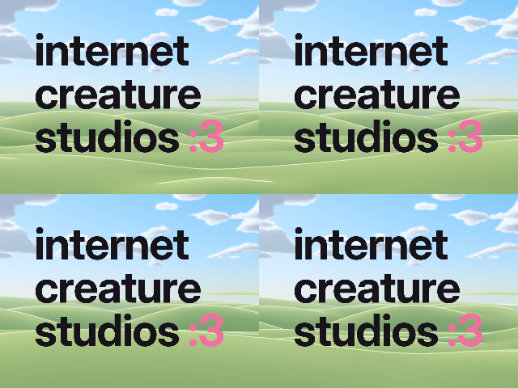

# GitHub Universe 2026 badge studio

Notes, tools and an example for building your own apps for the GitHub
Universe 2026 badge, a Pimoroni Badger 2350 running MonaOS. It's written so an
AI coding agent (or a person) can start building on the badge without
rediscovering how it works:

- how to get code onto it,
- how to recover it,
- what its API does,
- what things cost.



**Examples:**

- [Internet Creature Studios](examples/internet-creature-studios): the
  studio's logo over its site's hills, drawn live as parallax layers that race
  left or right as you tilt the badge, at about 30 fps. It adds a `:3` menu
  icon with a blinking selection animation.
- [Repo Defender](examples/repo-defender): defend your main branch from rogue
  AI bots. Turn to aim (the gyro tracks you), weapons fire automatically, and
  Left and Right switch them. It's playable seated.

## Start here

| | |
| --- | --- |
| [AGENTS.md](AGENTS.md) | Rules and workflow for AI agents (Claude Code reads it through `CLAUDE.md`) |
| [docs/workflow.md](docs/workflow.md) | Serial and disk mode, deploying safely, resetting and recovering |
| [docs/hardware.md](docs/hardware.md) | The badge, its firmware, storage and sensors |
| [docs/api.md](docs/api.md) | The Badgeware API as used on the badge |
| [docs/performance.md](docs/performance.md) | Measured costs, the frame budget, and what works |
| [docs/menu.md](docs/menu.md) | How apps get menu tiles, icons and animations |

## Quick start

You need a Mac with [`uv`](https://docs.astral.sh/uv/) and the badge on
USB-C. Everything else runs through `uvx`.

```bash
# Is it there? (serial port in normal mode)
ls /dev/cu.usbmodem*
uvx mpremote connect /dev/cu.usbmodem1101 fs ls :/system/apps

# Install the example app and its menu icon, then verify them on the badge
python3 tools/deploy.py
```

`tools/deploy.py` handles disk mode, the macOS traps with the badge's FAT
drive, and checking the result on the badge itself. See
[docs/workflow.md](docs/workflow.md#installing-with-the-deploy-script).

If the badge shows no serial port and no drive, it has hung: press RESET on
the back once.

## Layout

```
badge/      mirrors the badge's /system drive: what this repo installs
stock/      the firmware's original copies of files badge/ replaces
examples/   how each example's assets are made
tools/      deploy.py: safe install with verification; menu_icon.py: menu icons
docs/       what's known about the badge
```

`badge/apps/menu/` and `stock/apps/menu/` hold the badge firmware's menu icon
table: the stock version, and one with the example's icon added.
