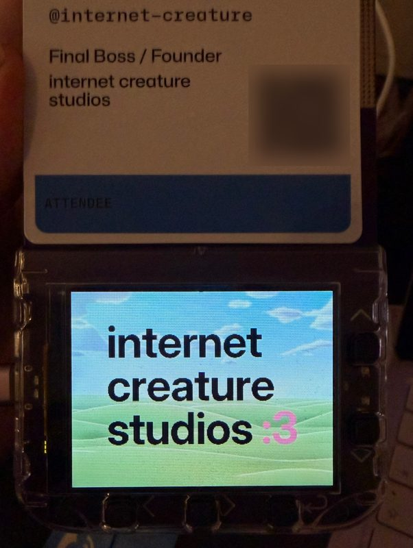
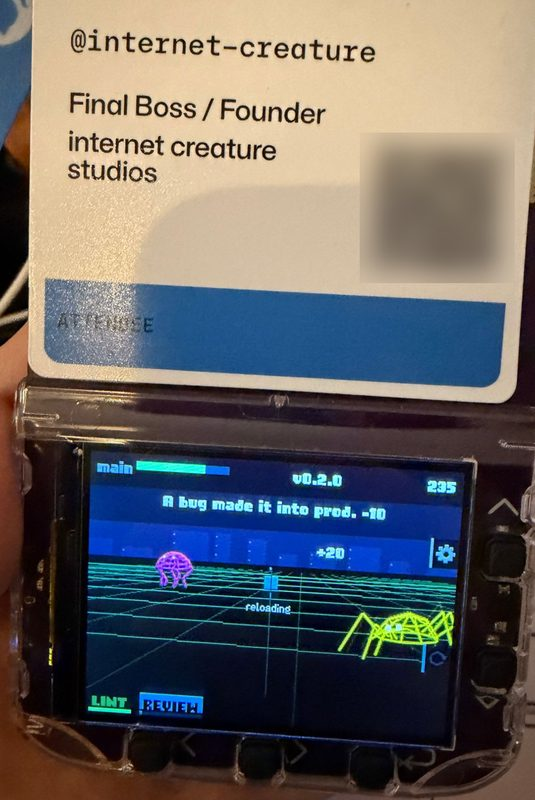

# GitHub Universe '26 Badge Buddy

Two apps, deployment tools, and practical notes for making things on the
GitHub Universe 2026 badge: a Pimoroni Badger 2350 running MonaOS.

To try the apps, follow [Install on your badge](#install-on-your-badge).
To make your own, start with [Build and customize](#build-and-customize).
The notes cover getting code onto the badge, its API and performance, and
recovering when something goes wrong.

## What's included

| App | What it does | More |
| --- | --- | --- |
| **Internet Creature** | The studio's logo over live parallax hills. Tilt the badge to make them race left or right, at about 30 fps. Includes a blinking `:3` menu icon. | [Controls](#launch-and-controls) · [How it's made](examples/internet-creature-studios/README.md) |
| **Repo Defender** | Defend your main branch from rogue AI bots. Turn to aim, fire automatically, and earn weapons and upgrades between releases. Playable seated. | [Controls](#launch-and-controls) · [Game guide](examples/repo-defender/README.md) |

 

 

The apps and their built assets are included. You don't need to generate
images or compile anything to install them.

## Install on your badge

### 1. Get the repo and tools

These instructions and `tools/deploy.py` are for **macOS**. You'll need:

- A GitHub Universe 2026 badge with its MonaOS firmware.
- A USB-C cable that carries data, with the badge connected to your Mac.
- Git, Python 3, and [`uv`](https://docs.astral.sh/uv/getting-started/installation/).
  The deploy script runs `mpremote` through `uvx`; no separate `mpremote`
  installation is needed.

```bash
git clone https://github.com/internet-creature-studios/gh-universe-26-badge-buddy.git
cd gh-universe-26-badge-buddy
```

Run the commands below from this repo's root folder.

### 2. Find the badge

In normal mode the badge shows its menu and provides a serial port:

```bash
ls /dev/cu.usbmodem*
```

The deploy script automatically chooses the port if there's only one. If
several match, add `--port` followed by your badge's full port path to each
deploy command. Find the right one by checking which disappears when you
unplug the badge and returns when you reconnect it.

If a `BADGER` drive is mounted, the badge is in disk mode. Eject it first:

```bash
diskutil eject /Volumes/BADGER
```

Wait for the menu and serial port to return. If neither a port nor a drive
appears, see [Troubleshooting](#troubleshooting).

### 3. Preview the install, then deploy

**The default install includes both apps and shared menu files.** Local
`badge/<path>` files go to `/system/<path>` on the badge:

| Local folder | What it installs |
| --- | --- |
| `badge/apps/internet_creature/` | Internet Creature and its scene assets |
| `badge/apps/repo_defender/` | Repo Defender and its logo |
| `badge/apps/menu/` | The shared icon table and Internet Creature's icon animation |

Existing files at those paths are replaced when they differ. In particular,
**deploying the menu replaces its icon table**: if you've added your own
icons, merge those entries first or use an app-only install below. Other
apps and extra files are kept by default. This installs files; it doesn't
flash firmware.

```bash
python3 tools/deploy.py --dry-run
python3 tools/deploy.py
```

The dry run shows which files would change without writing badge files. It
still connects to the badge, interrupts the running app, and resets to the
menu afterwards.

The install checks space, switches to disk mode, copies changed files,
cleans up macOS metadata, ejects, then verifies hashes on the badge itself.
Success ends with `verified … on the badge; it's back on its menu`, or
`already up to date` if nothing differs. A non-zero exit or a verification
error means the install needs attention; read the output before trying again.

### Install just one app

To keep the shared menu files as they are, pass only the app folder:

```bash
python3 tools/deploy.py badge/apps/internet_creature --dry-run
python3 tools/deploy.py badge/apps/internet_creature
```

For the game, use `badge/apps/repo_defender` instead. The menu discovers
installed apps automatically; an app without an entry in the icon table gets
a generic icon. You can install `badge/apps/menu` separately later.

For all options, run `python3 tools/deploy.py --help`. Use `--prune` only
when you want to delete extra files inside a chosen app folder, and preview
that exact command with `--dry-run` first. See the
[deployment guide](docs/workflow.md#installing-with-the-deploy-script) for details.

## Launch and controls

After installation, select **Internet Creature** or **Repo Defender** in
the badge menu and press **Enter (↩)**. Left, Right, and Enter are on the
bottom row; Up and Down are on the right edge.

### Internet Creature

- **Tilt left or right** to steer the hills. Held level, they drift gently.
- **Press Enter (↩) twice** to exit to the menu. Other buttons only show a
  reminder of that, so it's safe to leave running. Home also exits.

### Repo Defender

Press **Enter** on the title screen to start, then hold the badge still for
the initial aiming calibration. Your weapon fires automatically.

| Action | Control |
| --- | --- |
| Aim | Turn your body or the badge about 30° either way |
| Switch unlocked weapons | Left / Right |
| Reload early | Down |
| Choose an upgrade | Left / Right, then Enter |
| Pause / resume | Enter opens the pause menu; Enter again resumes by default |
| Open / close settings | Up, after the splash screen |
| Exit the app | Enter to pause, then Quit |

In settings, Down moves between rows and Enter selects. **Turning** switches
between rotate and tilt aiming; **Reset origin** recenters your aim. See the
[game guide](examples/repo-defender/README.md) for weapons, upgrades, and pickups.

## Build and customize

The apps run on the badge using Badgeware's built-in drawing and input API.
Desktop Python is used for the tools and asset scripts.

- **Tune the hills:** edit the constants near the top of
  [`badge/apps/internet_creature/__init__.py`](badge/apps/internet_creature/__init__.py),
  such as `RACE`, `TILT_CURVE`, `RESPONSE_MS`, and `TILT_SIGN`.
- **Tune the game:** start with `WEAPONS`, `BOTS`, `BASE_STATS`, `UPGRADES`,
  and the aiming constants in
  [`badge/apps/repo_defender/__init__.py`](badge/apps/repo_defender/__init__.py).
- **Make a new app:** create `badge/apps/<your_app>/__init__.py` and follow
  the [app shape](docs/api.md#app-shape). Load assets relative to that folder,
  exit on Back, and restore any display settings you change.

Try new code from the writable root before installing it under `/system`;
the [development workflow](docs/workflow.md#trying-an-app-without-installing-it)
shows how to copy to `/dev_app`, run with a timeout, and clean up afterwards.
Then deploy only your app folder. For a custom menu tile, follow the
[menu guide](docs/menu.md); an `icon.png` in the app folder isn't used.

**About the hills assets:** the included files are ready to use and can be
previewed locally. Rebuilding the terrain from scratch requires a preset
from the studio's private site repo, which isn't included here. The
[example guide](examples/internet-creature-studios/README.md) separates
previewing the supplied assets from regenerating them.

### Using an AI coding assistant

Have your assistant read [AGENTS.md](AGENTS.md) and
[docs/workflow.md](docs/workflow.md) before working with the badge.
`CLAUDE.md` points Claude Code to the same instructions. They cover safe
deployment, device testing, and known pitfalls. The guides below are useful
whether you're building by hand or with an assistant.

## Troubleshooting

| Situation | What to do |
| --- | --- |
| No serial port appears | Check the USB connection and use a data-capable cable. If `BADGER` is mounted, eject it. If neither appears while connected, press RESET on the back once. |
| Several serial ports appear | Add `--port` and the badge's full port path to the deploy command. |
| The deploy script says the badge is already in disk mode | Eject `/Volumes/BADGER`, wait for the serial port, then rerun. |
| `/system` is read-only over serial | That's expected. Install with `tools/deploy.py`, which switches to disk mode. |
| Verification fails or space runs out | Read the listed files/error and see the [deployment guide](docs/workflow.md#installing-with-the-deploy-script). Check the plan before deleting anything. |
| A serial command leaves the badge off its menu | Run `uvx mpremote connect YOUR_BADGE_PORT reset`, replacing `YOUR_BADGE_PORT` with its full path. |

For disk mode, crashes, and known calls that hang the badge, see
[reset and recovery](docs/workflow.md#reset-and-recovery).

## Reference and repo layout

| Guide | Use it for |
| --- | --- |
| [Workflow](docs/workflow.md) | Serial and disk mode, temporary app testing, safe deployment, recovery |
| [Hardware](docs/hardware.md) | Firmware, storage, buttons, and sensors |
| [API](docs/api.md) | Badgeware drawing, images, input, and app lifecycle |
| [Performance](docs/performance.md) | Measured costs, memory, and frame budgets |
| [Menu](docs/menu.md) | App names, custom icons, and selection animations |

```text
badge/      Files to install; mirrors the badge's /system paths
stock/      Original firmware files, kept for reference and restoration
examples/   App guides, asset scripts, source images, and previews
tools/      Deployment, menu icons, button positions, and screen captures
docs/       Hardware, API, workflow, menu, and performance notes
design/     Design proposals for the apps, and the scripts that render them
```

Never copy, print, or commit the badge's `/system/secrets.py`.
