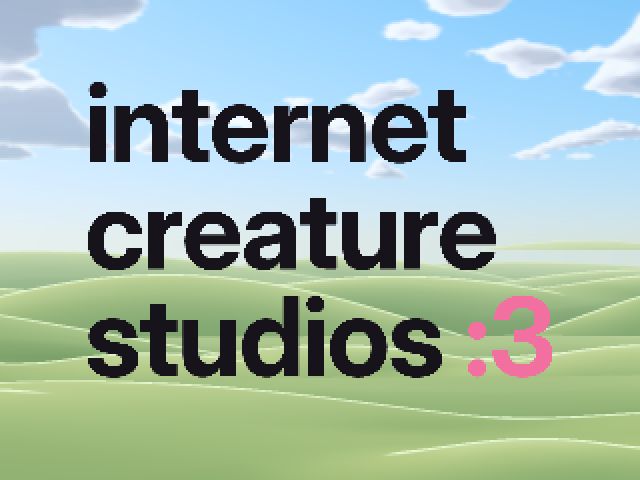
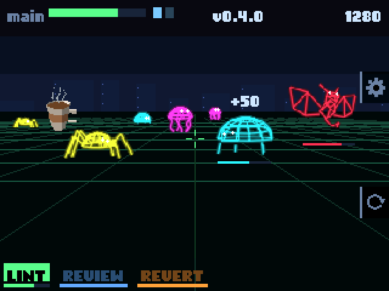

# GitHub Universe '26 Badge Buddy

Tools, notes, and a working example for building your own apps for the GitHub
Universe 2026 badge — a Pimoroni Badger 2350 running MonaOS.
It's written so you (or your AI) can start building right away, without
rediscovering how the badge works:

* [how to get code onto it](docs/workflow.md)
* [how to recover it if something goes wrong](docs/workflow.md#reset-and-recovery)
* [what it can do (the API)](docs/api.md)
* [what things cost (memory, speed, battery)](docs/performance.md)

**Examples:**

- [Internet Creature Studios](examples/internet-creature-studios): the
  studio's logo over its site's hills, drawn live as parallax layers that race
  left or right as you tilt the badge, at about 30 fps. It adds a `:3` menu
  icon with a blinking selection animation.

  

- [Repo Defender](examples/repo-defender): defend your main branch from rogue
  AI bots, neon wireframe creatures designed with Grok. Turn to aim (the gyro
  tracks you), weapons fire automatically, and you win more weapons and
  upgrades every release. It's playable seated.

  

## Start here

| | |
| --- | --- |
| [AGENTS.md](AGENTS.md) | Rules and workflow for AI agents (Claude Code reads it through `CLAUDE.md`) |
| [docs/workflow.md](docs/workflow.md) | Serial and disk mode, deploying safely, resetting and recovering |
| [docs/hardware.md](docs/hardware.md) | The badge, its firmware, storage and sensors |
| [docs/api.md](docs/api.md) | The Badgeware API as used on the badge |
| [docs/performance.md](docs/performance.md) | Measured costs, the frame budget, and what works |
| [docs/menu.md](docs/menu.md) | How apps get menu tiles, icons and animations |

## Quick start

You need a Mac with [`uv`](https://docs.astral.sh/uv/) and the badge on
USB-C. Everything else runs through `uvx`.

```bash
# Is it there? (serial port in normal mode)
ls /dev/cu.usbmodem*
uvx mpremote connect /dev/cu.usbmodem1101 fs ls :/system/apps

# Install the example app and its menu icon, then verify them on the badge
python3 tools/deploy.py
```

`tools/deploy.py` handles disk mode, the macOS traps with the badge's FAT
drive, and checking the result on the badge itself. See
[docs/workflow.md](docs/workflow.md#installing-with-the-deploy-script).

If the badge shows no serial port and no drive, it has hung: press RESET on
the back once.

## Layout

```
badge/      mirrors the badge's /system drive: what this repo installs
stock/      the firmware's original copies of files badge/ replaces
examples/   how each example's assets are made
design/     design proposals and the scripts that render them
tools/      deploy.py: safe install with verification; menu_icon.py: menu icons;
            locate_buttons.py: where the buttons sit beside the screen;
            raw2png.py: screen captures as PNGs
docs/       what's known about the badge
```

`badge/apps/menu/` and `stock/apps/menu/` hold the badge firmware's menu icon
table: the stock version, and one with the example's icon added.
