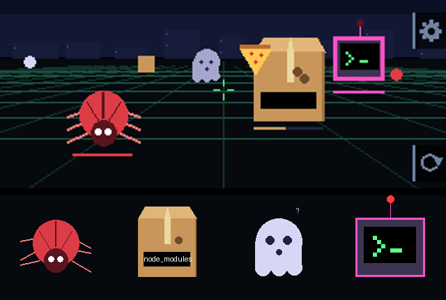

# Example: Repo Defender


A tongue-in-cheek first-person shooter: bugs, hallucinations and worse are
coming for your main branch. It plays seated.



## How it plays

- **Aim** by turning your body (or just the badge) about 30 degrees either way.
  In settings you can switch to steering by tilting the badge.
- **Your weapon fires by itself.** Left and Right switch weapons, and **Down**
  (right edge) reloads early. Weapons you aren't holding slowly refill, a full
  magazine in about 6 s. Each one suits different situations:
  - **LINT**: green, rapid fire, a 30-round magazine.
  - **REVIEW**: blue, heavy shots that **pierce** through everything in a line,
    4 rounds.
  - **REVERT**: orange, a wide spread of 5 pellets, 3 blasts. Good against
    anything swaying, up close.
- **Enemies** each come at you their own way:

  | Enemy | Approach | Health | Up close |
  | --- | --- | --- | --- |
  | Bug | fastest, straight at you | 4 | a red beetle, legs going |
  | node_modules | slowest, straight, tanky | 15 (3 REVIEW shots) | a cardboard box that dents as you hit it |
  | Hallucination | sways side to side, medium speed | 2 | a flickering ghost with a "?" |
  | Rogue agent | slow boss, every third release | 30 | a robot with a terminal for a face, prompt blinking |

- **Pickups** bob up and down where a destroyed enemy was. Shoot one within
  4.5 s to collect it:
  - **Pizza**: +25 health.
  - **Coffee**: overdrive, double fire rate for 5 s.
  - **Cache Hit**: a shield back. It only drops once you have shields.
  - **rm -rf**: deletes everything on the field, except the rogue agent, which
    had backups.
- **Upgrades.** Each wave is a "release" (v0.1.0 and up). When one ships, the
  game freezes on three upgrade cards. Left and Right choose, and enter takes
  it.
- **Shields** stop an enemy completely. Without one, an enemy that reaches you
  merges into main and costs you health.

## Upgrades

Every run starts from `BASE_STATS`. Each upgrade changes one stat, and its card
shows the stat now and after:

| Upgrade | Flavour | Effect |
| --- | --- | --- |
| Larger Runners | Your CI finally got the good machines. | +15% fire rate |
| CODEOWNERS | Nothing gets through without your say-so. | +1 damage on every hit |
| Copilot | Fight AI with AI. Seems only fair. | +25% damage |
| Bug Bounty | Bugs drop loot now. Finders keepers! | +8% pickup chance (from 10%) |
| Automated PR Review | Reloads approve themselves. LGTM! | 15% faster reloads (from 1.2 s) |
| Branch Protection | main has been hitting the gym. | +20 max health (from 100), and heals 20 |
| Two-Factor Auth | Bugs never have their phone on them. | +1 recharging shield, up to 3 |

Damage per pellet is `(weapon damage + flat) × (1 + increased)`. A shield comes
back 8 s after an enemy last reached you, then one every 8 s.

## Buttons and screens

The side buttons always mean the same thing, and overlays beside them show it:

- **Up is settings, on every screen.** It freezes whatever's going on, and Up
  again closes it. In settings, Down moves between rows and enter takes one:
  - **Turning:** rotate (the default: turn your body, using the gyro) or tilt
    (tip the badge left or right to turn that way, and hold it level to stop).
    Left and Right also switch it. Both cover the same ±30°.
  - **Reset origin:** makes the way you're facing (or holding the badge)
    straight ahead.
  - **Back.**
- **Down reloads** in a game, and moves to the next row in menus.
- **Enter** starts a game, and in a game pauses it: Resume, Restart or Quit.
  Down (or Left and Right) choose, and enter confirms. Resume is the default,
  so enter twice is pause and unpause.
- **Back** exits at any time.

There's more on screen:

- **The splash** shows the studio's logo, a line at a time, then the pink `:3`.
- **The title and menus** point at the buttons they use: a glowing copy of the
  printed `↩` and an arrow for enter, and chevrons for Left and Right. The
  positions come from [docs/button_positions.json](../../docs/button_positions.json).
- **The best score and settings** are kept in `/state/repo_defender.json`.

The app is [`badge/apps/repo_defender/__init__.py`](../../badge/apps/repo_defender/__init__.py).
It's drawn entirely with rectangles, triangles, circles, lines and text, with
no image assets except the logo. Far-off enemies are drawn as a single shape,
and only close ones get detail.

## How aiming works

- **Rotate** measures turning around "down". The accelerometer gives the
  direction of gravity, and the yaw rate is the gyro's reading along it, so it
  works however the badge is tilted in your hands. Two full turns measured 107
  and 110 raw units per degree per second (`GYRO_LSB_PER_DPS`). The game
  calibrates from the steadiest part of a one-second hold at the start, and
  keeps re-learning the gyro's zero point whenever the badge holds still.
  Turning past ±30° drags the centre along with you.
- **Tilt** reads the accelerometer's sideways component against how the badge
  was held at the start, or at the last Reset origin. Past a small dead zone,
  turning speeds up to 70°/s.
- **One projection for everything.** The grid, skyline, enemies, pickups, shots
  and hit tests all go through the same `View`, so `YAW_SIGN` is the only
  direction choice.

Tuning knobs, at the top of the app:

- **Aim:** `YAW_LIMIT`, `YAW_SIGN`, `HFOV`, `TILT_*`.
- **Pace:** `WAVE_SECONDS`, and the spawn mix and curve in `Game.spawn` and
  `Game.update`.
- **Enemies and weapons:** the `ENEMIES` and `WEAPONS` tables, and
  `HOLSTER_REFILL`.
- **Progression:** `BASE_STATS`, `UPGRADES`, `PICKUPS`, and the shield and
  pickup timings.

## Testing the rules on the badge

[`selftest.py`](selftest.py) runs the game's own code on the badge with its
run loop swapped for 19 checks. They cover:

- firing, reload timing, early reloads and holster refills
- each enemy's health, and REVIEW piercing through a line
- every pickup, including rm -rf sparing the boss
- shields stopping an enemy and recharging
- the upgrade offers
- Reset origin, and which way tilt turns
- every screen and enemy drawing

Then it measures the frame rate of a busy scene. All 19 checks pass. The busy
scene, with 12 enemies and 4 pickups at once, runs at about 22 fps; normal play
has far fewer on screen. How to run it is at the top of the file.

## The menu icon

A shield guarding a little commit graph. To rebuild it:

```bash
python3 examples/repo-defender/make_icon.py examples/repo-defender/icon.json preview.png
python3 tools/menu_icon.py repo_defender examples/repo-defender/icon.json
python3 tools/deploy.py badge/apps/menu
```
