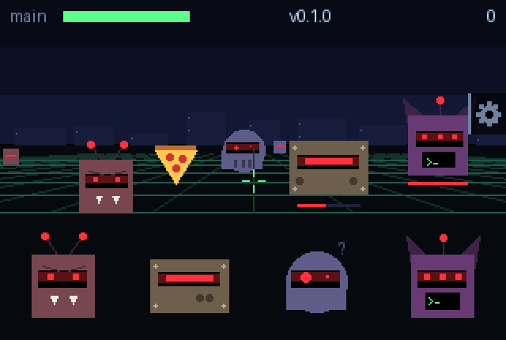
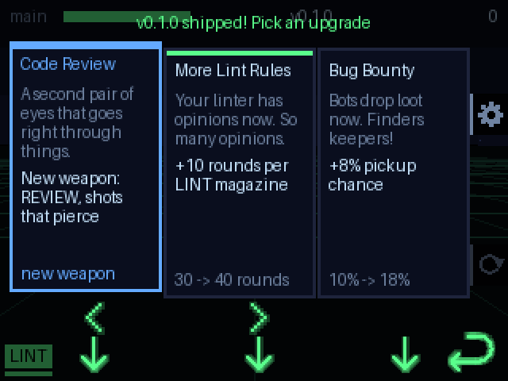

# Example: Repo Defender

A tongue-in-cheek first-person shooter: evil bots are coming for your main
branch. It plays seated.

## Install and start playing

Follow the repo's [installation guide](../../README.md#install-on-your-badge)
for prerequisites and port discovery. From the repo root, install just the
game with:

```bash
python3 tools/deploy.py badge/apps/repo_defender --dry-run
python3 tools/deploy.py badge/apps/repo_defender
```

Open **Repo Defender** in the badge menu, press **Enter (↩)** to start, and
hold the badge still for the initial aiming calibration. Turn to aim; your
weapon fires automatically. **Down** reloads, **Left / Right** switches
unlocked weapons, **Enter** pauses, **Up** opens settings, and **Back** exits.
Left, Right, and Enter are on the bottom row; Up and Down are on the right
edge. [Buttons and screens](#buttons-and-screens) covers the menus in detail.

The game and its logo are ready to install. For its custom menu icon, use the
full install in the installation guide, which explains the shared menu
files it replaces.



## How it plays

- **Aim** by turning your body (or just the badge) about 30 degrees either way.
  In settings you can switch to steering by tilting the badge.
- **Your weapon fires by itself.** **Down** (right edge) reloads early. You
  start with LINT, and win the others from upgrade cards. Left and Right switch
  between the weapons you have, and the ones you aren't holding slowly refill,
  a full magazine in about 6 s. Each one suits different situations:
  - **LINT**: green, rapid fire, a 30-round magazine.
  - **REVIEW**: blue, heavy shots that **pierce** through everything in a line,
    4 rounds.
  - **REVERT**: orange, a wide spread of 5 pellets, 3 blasts. Good against
    anything swaying, up close.
- **Bots** are all evil heads with red eyes, and each kind comes at you its own
  way:

  | Bot | Approach | Health | Up close |
  | --- | --- | --- | --- |
  | Bug | fastest, straight at you | 4 | two antennae, angry brows and fangs |
  | node_modules | slowest, straight, tanky | 15 (3 REVIEW shots) | a wide riveted head with one long eye slit, denting as you hit it |
  | Hallucination | sways side to side, medium speed | 2 | a flickering dome with mismatched eyes and a "?" |
  | Rogue agent | slow boss, every third release | 30 | horns, three eyes, and a terminal for a mouth, prompt blinking |

- **Pickups** sometimes drop when you destroy a bot. One lands 12° to 19° to the
  side of where you're aiming, so you see it before you shoot it, and bobs up
  and down. Shoot it within 4.5 s to collect it:
  - **Pizza**: +25 health.
  - **Coffee**: overdrive, double fire rate for 5 s.
  - **Cache Hit**: a shield back. It only drops once you have shields.
  - **rm -rf**: deletes every bot on the field, except the rogue agent, which
    had backups.
- **Upgrades.** Each wave is a "release" (v0.1.0 and up). When one ships, the
  game freezes on three upgrade cards. Left and Right choose, and enter takes
  it.
- **Shields** stop a bot completely. Without one, a bot that reaches you merges
  into main and costs you health.

## Upgrades



Each release offers three different cards, drawn from the stat cards and the
weapon cards together. Every card shows what it changes, now and after. The
screen marks Left, Right and enter with a glowing `<`, `>` and ✓ right over each
button.

**+ cards.** Any card offered has a 15% chance (`PLUS_CHANCE`) of being its +
version, such as Copilot+, in a gold frame. A + card does twice as much:

- A stat card's increase is doubled, such as +30% fire rate or +40 max health.
- A weapon card for a weapon you have boosts it twice.
- A weapon card for a new weapon gives it to you already boosted once.
- **Two-Factor Auth+** adds one shield, like the plain card, and fully heals
  you.

**Weapon cards** give you a weapon you don't have yet, straight into your hands.
Once you have it, the same weapon's card improves it instead:

| Weapon | Without it | Once you have it |
| --- | --- | --- |
| LINT (green) | You start with it. | **More Lint Rules**: +10 rounds per magazine |
| REVIEW (blue) | **Code Review**: unlocks it | **Senior Reviewer**: +2 damage per shot |
| REVERT (orange) | **git revert**: unlocks it | **Revert Harder**: +1 pellet in the spread |

**Stat cards** each change one stat, for every weapon. Every run starts from
`BASE_STATS`:

| Upgrade | Flavour | Effect |
| --- | --- | --- |
| Larger Runners | Your CI finally got the good machines. | +15% fire rate |
| CODEOWNERS | Nothing gets through without your say-so. | +1 damage on every hit |
| Copilot | Fight AI with AI. Seems only fair. | +25% damage |
| Bug Bounty | Bots drop loot now. Finders keepers! | +8% pickup chance (from 10%) |
| Automated PR Review | Reloads approve themselves. LGTM! | 15% faster reloads (from 1.2 s) |
| Branch Protection | main has been hitting the gym. | +20 max health (from 100), and heals 20 |
| Two-Factor Auth | Bots never have their phone on them. | +1 recharging shield, up to 3 |
| Friday Deploy | What could possibly go wrong? | +10% score, but bots get +10% health and speed |

Damage per pellet is `(weapon damage + flat) × (1 + increased)`. A shield comes
back 8 s after a bot last reached you, then one every 8 s. Friday Deploy is a
gamble: it stacks with every pick (+20% each for the + card), and makes
every bot that arrives afterwards tougher and faster.

## Buttons and screens

The side buttons always mean the same thing, and overlays beside them show it:

- **Up opens settings after the splash.** It freezes whatever's going on, and Up
  again closes it. In settings, Down moves between rows and enter takes one:
  - **Turning:** rotate (the default: turn your body, using the gyro) or tilt
    (tip the badge left or right to turn that way, and hold it level to stop).
    Left and Right also switch it. Both cover the same ±30°.
  - **Reset origin:** makes the way you're facing (or holding the badge)
    straight ahead.
  - **Back.**
- **Down reloads** in a game, and moves to the next row in menus.
- **Enter** starts a game, and in a game pauses it: Resume, Restart or Quit.
  Down (or Left and Right) choose, and enter confirms. Resume is the default,
  so enter twice is pause and unpause.
- **Back** exits at any time.

There's more on screen:

- **The splash** shows the studio's logo, a line at a time, then the pink `:3`.
- **The title and menus** point at the buttons they use: a glowing copy of the
  printed `↩` and an arrow for enter. The upgrade screen puts a `<`, `>` and ✓
  right over Left, Right and enter. The positions come from
  [docs/button_positions.json](../../docs/button_positions.json).
- **The best score and settings** are kept in `/state/repo_defender.json`.

The app is [`badge/apps/repo_defender/__init__.py`](../../badge/apps/repo_defender/__init__.py).
It's drawn entirely with rectangles, triangles, circles, lines and text, with
no image assets except the logo. Far-off bots are drawn as a head and a band of
red eyes, and only close ones get detail.

## Customize the game

Edit [`badge/apps/repo_defender/__init__.py`](../../badge/apps/repo_defender/__init__.py)
and redeploy the same app folder. To try changes without installing them,
follow the [temporary app workflow](../../docs/workflow.md#trying-an-app-without-installing-it).

### How aiming works

- **Rotate** measures turning around "down". The accelerometer gives the
  direction of gravity, and the yaw rate is the gyro's reading along it, so it
  works however the badge is tilted in your hands. Two full turns measured 107
  and 110 raw units per degree per second (`GYRO_LSB_PER_DPS`). The game
  calibrates from the steadiest part of a one-second hold at the start, and
  keeps re-learning the gyro's zero point whenever the badge holds still.
  Turning past ±30° drags the centre along with you.
- **Tilt** reads the accelerometer's sideways component against how the badge
  was held at the start, or at the last Reset origin. Past a small dead zone,
  turning speeds up to 70°/s.
- **One projection for everything.** The grid, skyline, bots, pickups, shots
  and hit tests all go through the same `View`, so `YAW_SIGN` is the only
  direction choice.

### Tuning knobs

These constants and tables are near the top of the app:

- **Aim:** `YAW_LIMIT`, `YAW_SIGN`, `HFOV`, `TILT_*`.
- **Pace:** `WAVE_SECONDS`, and the spawn mix and curve in `Game.spawn` and
  `Game.update`.
- **Bots and weapons:** the `BOTS` and `WEAPONS` tables, and `HOLSTER_REFILL`.
- **Progression:** `BASE_STATS`, `UPGRADES`, `WEAPON_CARDS`, `PLUS_CHANCE`,
  `PICKUPS`, `PICKUP_OFFSET`, and the shield and pickup timings.

## Testing the rules on the badge

[`selftest.py`](selftest.py) runs the game's own code on the badge with its
run loop swapped for 34 checks. They cover:

- firing, reload timing, early reloads and holster refills
- starting with LINT, each weapon card unlocking or boosting its weapon, and
  Left and Right skipping weapons you don't have
- + cards: how often they come up, and what each kind does
- Friday Deploy's score and bot toughness
- where pickups land
- that every card's text fits, measured in the badge's own fonts
- each bot's health, and REVIEW piercing through a line
- every pickup, including rm -rf sparing the boss
- shields stopping a bot and recharging
- the upgrade offers
- Reset origin, and which way tilt turns
- every screen and bot drawing

Then it measures the frame rate of a busy scene. All 34 checks pass. The busy
scene, with 12 bots and 4 pickups at once, runs at about 22 to 24 fps; normal
play has far fewer on screen. How to run it is at the top of the file.

## The menu icon

A shield guarding a little commit graph. The compiled icon table is already
included. To rebuild it from the repo root, the preview renderer needs
Pillow and the icon tool compiles through `uvx mpy-cross`:


```bash
uv run --with pillow examples/repo-defender/make_icon.py examples/repo-defender/icon.json preview.png
python3 tools/menu_icon.py repo_defender examples/repo-defender/icon.json
python3 tools/deploy.py badge/apps/menu --dry-run
python3 tools/deploy.py badge/apps/menu
```

This deploys shared menu files; merge any other custom icon entries before
installing them. See the [menu guide](../../docs/menu.md) for the icon format.
